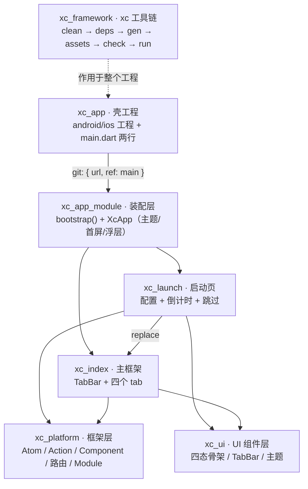
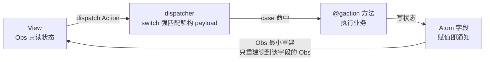
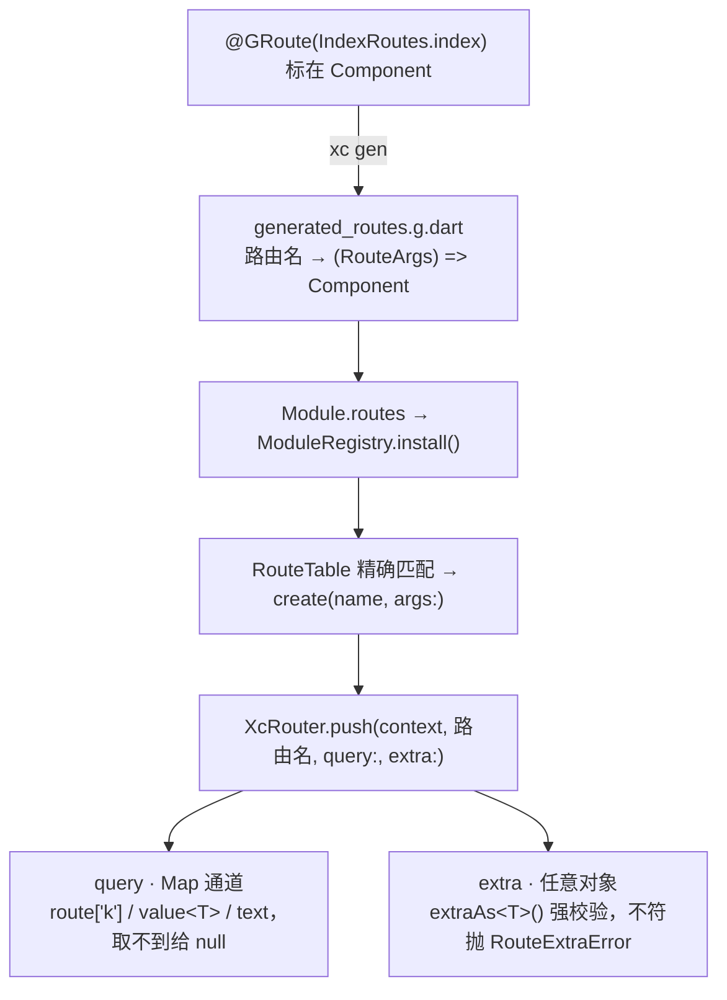
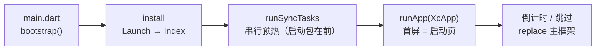

# 响彻星空 App 架构说明

> 更新时间：2026-11-09 · 覆盖仓库：xc_app / xc_app_module / xc_launch / xc_index / xc_platform / xc_ui / xc_framework

「响彻星空」App 按「**壳 → 装配 → 业务 → 框架**」四层拆成多个独立 git 仓库，
壳工程不掺业务，装配集中在装配层，框架与 UI 分层，一切接线由代码生成器完成。

## 一、仓库分层与 git 接入



| 仓库 | 层 | 职责 | 对外出口 |
| --- | --- | --- | --- |
| `xc_app` | 壳 | 平台工程 + 入口 | 无（只有 `main.dart` 两行） |
| `xc_app_module` | 装配 | Module 安装、MaterialApp、主题、首屏、全局浮层 | `bootstrap()`、`XcApp` |
| `xc_launch` | 业务 | 启动配置、倒计时、跳过 | `LaunchModule`、`LaunchRoutes` |
| `xc_index` | 业务 | 底部 TabBar、四个 tab、全局浮层 | `IndexModule`、`IndexRoutes` |
| `xc_platform` | 框架 | 响应式内核、Action 派发、Component 三件套、路由、Module、页面四态、声明式网络 | `xc_platform.dart` 全量导出 |
| `xc_ui` | UI | 加载/空/错误骨架、`XcBottomTabBar`、`KeepAliveWrapper`、`XcTheme` | 纯受控组件，不读 Model |
| `xc_framework` | 工具 | `xc` 命令行工具链 | `clean / deps / gen / assets / check / run` |

### 接入规则

- 所有仓库统一 `main` 分支，壳与装配层用 `git: { url, ref: main }` 接入；
  本地阶段 `url` 是绝对路径，上远程后只改 `url`。
- **git 依赖只认已提交内容**：改完某仓库的 pubspec/代码必须 commit，下游才能 `pub get` 到。
- **pub 的 git 依赖不允许 path 指向仓库外**，所以每个包都必须是自洽的单包仓库。
- 本地联调未提交改动：用 `dependency_overrides:` 临时指向本地 `path:`，业务代码零改动。

```yaml
# xc_app/pubspec.yaml —— 壳工程唯一的业务依赖
dependencies:
  flutter:
    sdk: flutter
  xc_app_module:
    git:
      url: <xc_app_module 仓库地址>   # 本地仓库阶段是绝对路径
      ref: main
```

## 二、运行时：一个页面内部的数据流

每个页面固定三件套：`XxxComponent`（装配）/ `XxxModel`(状态 + 业务) / `XxxView`（只读 + 回调）。



- **响应式**：`Atom` 是 mobx `Observable` 的薄封装，`Obs` 是 `Observer`；
  业务侧看不到任何 mobx API，写状态就是普通赋值（生成器把字段接管成 Atom）。
- **代码生成**（`xc gen`，产出入库为 `.g.dart` part 文件）：
  1. `_$XxxModelImpl`：把 `var userName = '未登录';` 接管成 Atom + getter/setter（`@gignore` 字段只读）；
  2. `createXxxModel()` 工厂；
  3. `XxxModelIntents`：按 `@gaction` 方法签名生成 `static Action`，View 只从这里拿；
  4. `createXxxModelDispatcher(model)`：**switch 强匹配**——名字/个数/类型对不上直接落 default 抛错。
- **意图边界**：只有 `@gaction` 方法进 switch（View 可 dispatch）；普通方法是内部流转函数。
- **页面四态**：`loading / empty / error / content` 由 `WModel.pageState` 统一管理，
  View 的 build 返回一个 `Obs` 包住 Scaffold，按 status 换骨架（来自 `xc_ui`）。
- **Model 生命周期**：`init()` 子类必写（首屏请求在这里）；`dispose` 不可重写，
  清理逻辑写 `onDispose()`；`autoDispose` 统一释放 Atom 与 `addDisposable` 登记的资源。

## 三、路由：注解声明，生成器接线

路由表不手写，从注解到跳转全链路自动化：



两条参数通道语义刻意不同：

| 通道 | 类型 | 取法 | 失败行为 |
| --- | --- | --- | --- |
| `query` | `Map<String, Object?>`（可序列化） | `route['k']` / `route.text('k')` / `route.value<T>('k')` | 取不到或类型不符给 `null` |
| `extra` | `Object?`（不进 URL，传实体/回调） | `route.extraAs<T>()`，可选时先 `route.hasExtra` | 类型不符或没带 → 抛 `RouteExtraError` |

- 页面构造函数写 `super.route` 即可拿到参数；弹窗/中间层拿不到 route 时用 `XcRouter.argsOf(context)`（参数同时写进了 `RouteSettings.arguments`）。
- 带值返回：`final OrderResult? r = await XcRouter.push<OrderResult>(...); XcRouter.pop<OrderResult>(context, result)`。
- 跳转只认路由名常量（跨包只认各业务包暴露的 `XxxRoutes.*`），不写裸字符串。

## 四、启动时序



- **replace 不留栈**：进主框架后返回键回不到启动页。
- **全局浮层**：所有 Module 声明的 overlay 叠在 `MaterialApp.builder` 的 Stack 上，切路由不掉。
- **新增业务包三步**：新仓库按分支接入 → `xc_app_module` 的 `bootstrap()` 加一行
  `ModuleRegistry.install()` → 壳工程零改动。

## 五、工程运维：xc 工具链

```bash
xc            # 干净重建：clean → deps → gen → assets → check
xc run        # 同上 + 启动 App（缺 android/ios 会自动补齐）
xc run -d chrome
```

| 步骤 | 做什么 |
| --- | --- |
| `clean` | 清理构建产物与依赖缓存 |
| `deps` | 重新安装依赖 |
| `gen` | 重扫 `@GRoute` / `@gaction`，重出全部 `.g.dart` |
| `assets` | 为每个包生成 `lib/gen/assets_gen.dart`（资源常量自动带 `packages/<pkg>/` 前缀） |
| `check` | 静态分析 + 全部测试 |
| `run` | 启动 App |

资源跟着包走：业务包的图放该包 `assets/` 并在该包 pubspec 声明；App 图标/启动图才放壳工程。

## 六、当前验证状态

- 六个仓库 `flutter analyze` 全部 0 issue；
- 测试全绿：xc_app_module 20 个（启动链路 + 路由参数 + Model 生命周期）、xc_launch 5 个、xc_index 5 个；
- `xc_app` 的 `pub get` 已走通整条 git 依赖链（`pubspec.lock` 中各包均 `from git ... at <main 分支 commit>`）。
